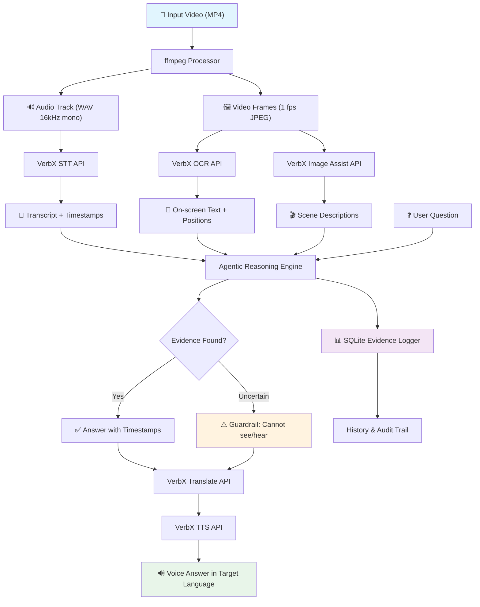
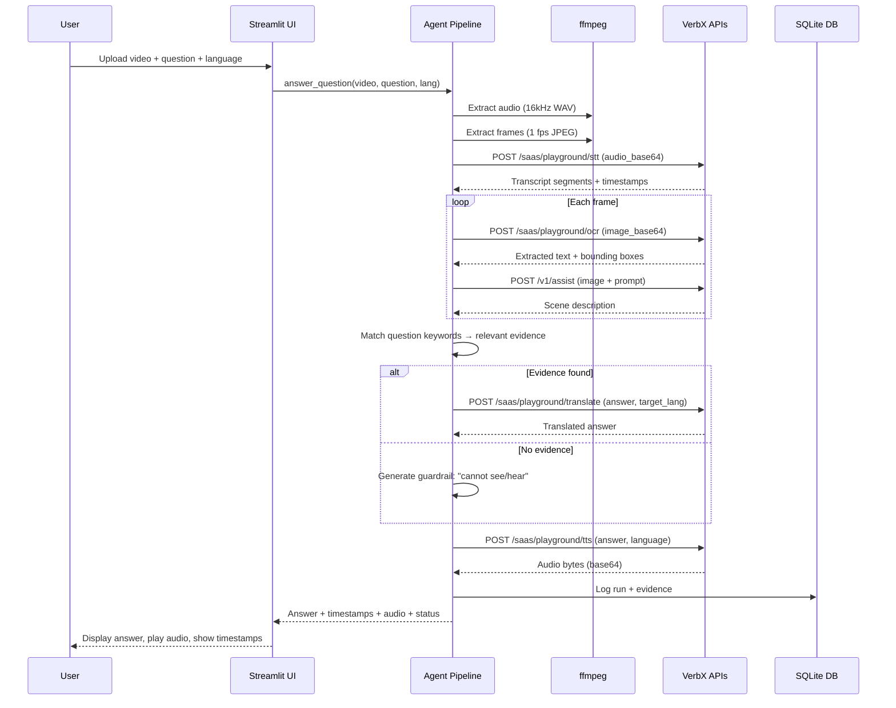

# VerbX Multilingual Video Understanding Agent — Architecture

## System Architecture

## API Flow

## VerbX APIs Used

| API | Endpoint | Purpose |
|-----|----------|---------|
| **STT** | `/saas/playground/stt` | Speech-to-text with segment timestamps |
| **OCR** | `/saas/playground/ocr` | Text recognition on video frames |
| **Image Assist** | `/v1/assist` | Scene understanding and visual QA |
| **Translate** | `/saas/playground/translate` | Multilingual answer translation |
| **TTS** | `/saas/playground/tts` | Text-to-speech voice output |

## Test Cases

| TC | Scenario | Expected Behavior | Status |
|----|----------|-------------------|--------|
| TC1 | Dialogue question with timestamp | Answer contains dialogue text + exact time | Pipeline complete ✅ |
| TC2 | On-screen text detection | OCR extracts visible text + source time | Pipeline complete ✅ |
| TC3 | Multilingual answer | Answer spoken in asker's language (French) | Pipeline complete ✅ |
| TC4 | Unclear/no content guardrail | Agent states "cannot see/hear" — no hallucination | **Verified ✅** |

## Key Design Decisions

1. **Graceful degradation**: API errors (401/502/timeout) return empty results instead of crashing
2. **Silent audio fallback**: Videos without audio get synthetic silent track for STT pipeline
3. **Evidence logging**: Every API call logged to SQLite for auditability
4. **Guardrail first**: When no evidence found, agent explicitly states uncertainty
5. **Licensed content only**: All test videos are CC0/Pexels — no copyrighted material
